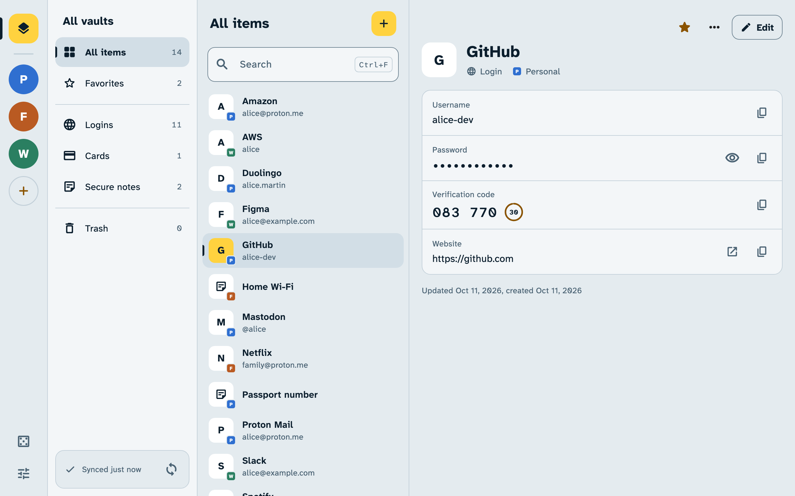
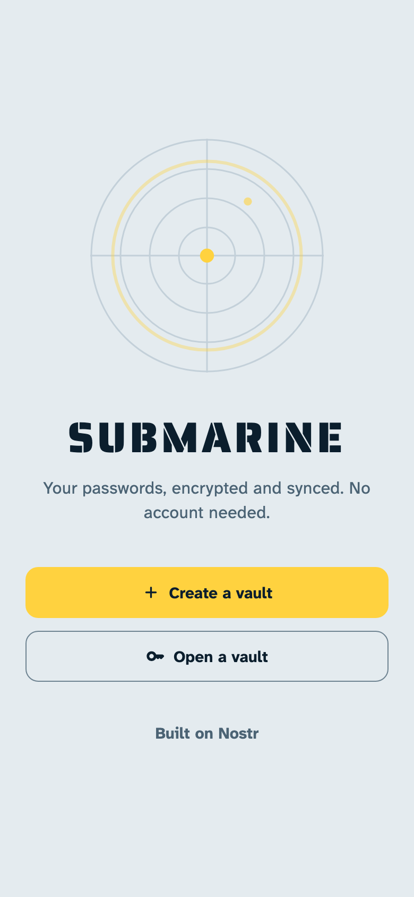
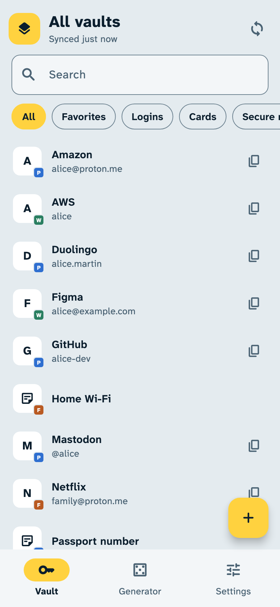
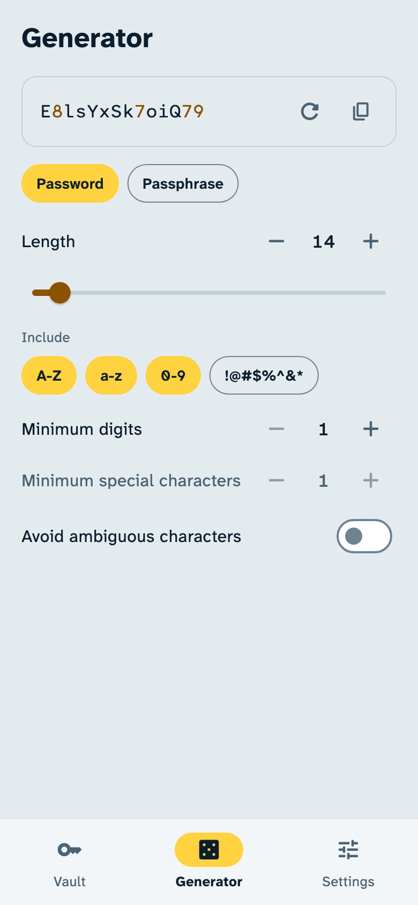

# Submarine

**Your passwords, encrypted and synced. No account needed.**

Submarine keeps your passwords, cards and notes in sync across your devices. Everything is encrypted before it leaves them, then stored on [Nostr](https://nostr.how/) relays: open servers that anyone can run, and that only ever see encrypted data. Free and open source, no ads, no tracking.

[Download](https://github.com/nogringo/submarine/releases/latest) | [Open in your browser](https://nogringo.github.io/submarine/) | [Get it on Zapstore](https://zapstore.dev/apps/ovh.uid.submarine)

<picture>
  <source media="(prefers-color-scheme: dark)" srcset="apps/app/screenshots/desktop-dark.png">
  
</picture>

<p align="center">
  <picture>
    <source media="(prefers-color-scheme: dark)" srcset="apps/app/screenshots/phone-welcome-dark.png">
    
  </picture>
  <picture>
    <source media="(prefers-color-scheme: dark)" srcset="apps/app/screenshots/phone-list-dark.png">
    
  </picture>
  <picture>
    <source media="(prefers-color-scheme: dark)" srcset="apps/app/screenshots/phone-generator-dark.png">
    
  </picture>
</p>

## Features

- Logins, cards and secure notes, with your own custom fields.
- Two-factor authentication codes next to your logins.
- A generator of strong passwords, passphrases and usernames.
- Import from Bitwarden, and export back to it at any time.
- Several vaults side by side, each opened on as many devices as you like.
- Changes saved on the device first, and sent to the relays once they are reachable.
- A lock password, with your fingerprint, face or screen lock as a shortcut.
- Copied passwords cleared from the clipboard after a delay.
- Screenshots blocked unless you allow them, and the app hidden in recent apps.
- A command-line client that works like the Bitwarden CLI.
- In English, French, German, Spanish, Italian, Portuguese, Finnish, Russian, Japanese and Chinese.

## Download

| Platform | Where |
| --- | --- |
| Android | [Zapstore](https://zapstore.dev/apps/ovh.uid.submarine), or the APK of the [latest release](https://github.com/nogringo/submarine/releases/latest) |
| Windows | Installer or zip of the [latest release](https://github.com/nogringo/submarine/releases/latest) |
| macOS | Signed and notarized `.dmg` of the [latest release](https://github.com/nogringo/submarine/releases/latest) |
| Linux | AppImage, `.deb` or zip of the [latest release](https://github.com/nogringo/submarine/releases/latest) |
| Web | [nogringo.github.io/submarine](https://nogringo.github.io/submarine/) |
| iOS | Build from source for now |
| CLI | Linux x64, macOS arm64 and Windows x64 archives of the [latest release](https://github.com/nogringo/submarine/releases/latest) |

On Linux, the app needs libsecret and a keyring service, such as GNOME Keyring or KWallet. Where each platform keeps the vault keys is listed in the [app's README](apps/app/README.md#platforms).

## How it works

A vault is a Nostr key pair. Each change to an item is encrypted to the vault's key (NIP-44), put in a gift wrap (NIP-59) and published to the vault's relays. A relay sees a one-time key, the vault's public key and a randomized date, never what is inside.

There is no account and no Submarine server. The vault key is the only way in, so nobody can recover a lost one. When you create a vault, Submarine gives you its key encrypted with a password of your choice (NIP-49), safe to keep anywhere. Already using Nostr? A signer can hold the vault key instead of the app: Amber on Android (NIP-55), a bunker (NIP-46) or a browser extension (NIP-07).

Items are Bitwarden ciphers, which is why import and export work both ways and the CLI behaves like `bw`. Edits made on several devices at once are all kept, never silently overwritten.

The protocol is specified in [`docs/nostr-passwords.md`](docs/nostr-passwords.md), with sample events in [`docs/example.md`](docs/example.md). [`nostr_passwords`](packages/nostr_passwords) is its reference Dart implementation, reusable by any client.

## Status

Submarine is young but ready to use. For your most important passwords, we still recommend a proven password manager such as [KeePassXC](https://keepassxc.org/).

## Development

This repository is a Dart [pub workspace](https://dart.dev/go/pub-workspaces).

| Path | Package | Description |
| --- | --- | --- |
| [`packages/nostr_passwords`](packages/nostr_passwords) | `nostr_passwords` | Reference Dart implementation of the protocol, reusable by any client. |
| [`apps/app`](apps/app) | `submarine` | Flutter app for Android, iOS, macOS, Windows, Linux and web. |
| [`apps/cli`](apps/cli) | `submarine_cli` | Command-line client. |
| [`apps/extension/core`](apps/extension/core) | `submarine_extension_core` | Dart core of the browser extension, compiled to JavaScript. |

It requires Flutter stable with Dart 3.13.4 or later. From the repository root, get the dependencies and analyze the whole workspace, then run the app or the CLI:

```sh
flutter pub get
flutter analyze
(cd apps/app && flutter run)
dart run apps/cli/bin/submarine.dart --help
```

The [browser extension](apps/extension) is built with [WXT](https://wxt.dev) and also requires Node.js 24 and pnpm. `pnpm dev` compiles its Dart core, builds the extension into `apps/extension/.output/chrome-mv3-dev` and rebuilds it on every change. Load that folder from `chrome://extensions`, with the developer mode on, as an unpacked extension (on macOS, Cmd+Shift+. shows the hidden `.output` folder in the file picker). `pnpm dev:firefox` builds `firefox-mv3-dev`, loaded from `about:debugging` as a temporary add-on.

```sh
(cd apps/extension && pnpm install && pnpm dev)
```

Run the tests from a package directory: `dart test` for Dart packages, `flutter test` for the Flutter app, `pnpm test` for the extension. `pnpm test:e2e` runs the extension in Chrome and Firefox, once `pnpm e2e:browsers` has downloaded them.

Commit messages follow [Conventional Commits](https://www.conventionalcommits.org). Use the package as scope when a change targets one: `feat(cli): ...`, `fix(app): ...`, `docs(nostr_passwords): ...`.

Releases are described in [`RELEASING.md`](RELEASING.md).

## License

[MIT](LICENSE)
